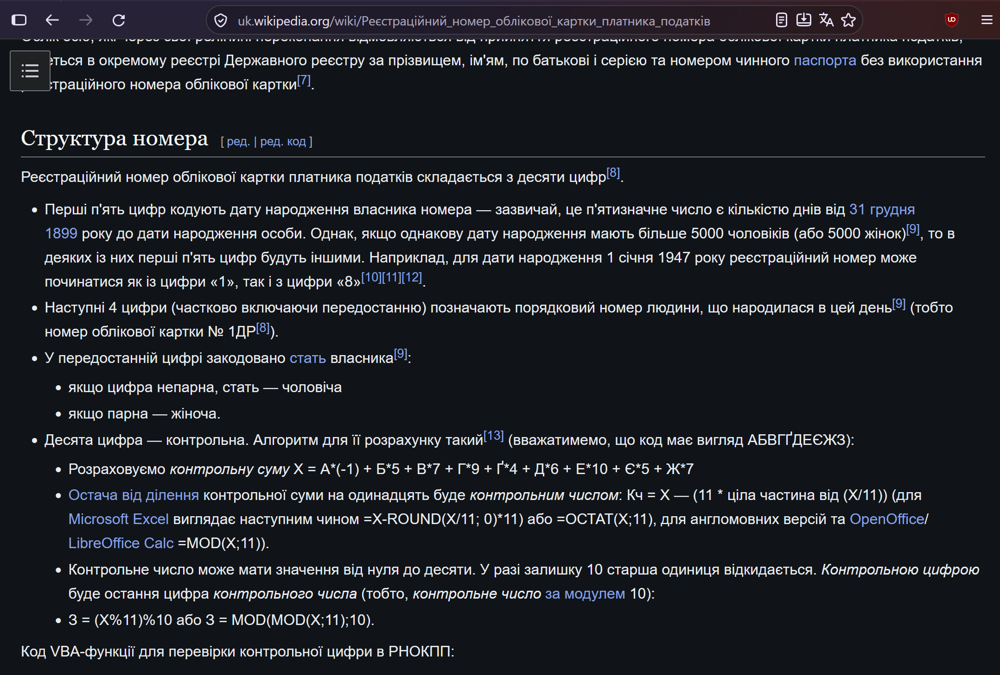

# Структура номера

Регистрационный номер учетной карточки налогоплательщика (РНОКПП) в Украине состоит из десяти цифр.

Первые пять цифр обычно соответствуют количеству дней между 31 декабря 1899 года и датой рождения
человека. В исключительных случаях, когда количество людей одного пола с одинаковой датой рождения
превышает 5000, начальная пятизначная часть может формироваться иначе.

Цифры с шестой по девятую образуют порядковую часть номера. Предпоследняя цифра также используется
для кодирования пола: нечётное значение соответствует мужскому полу, чётное - женскому.

Последняя, десятая цифра является контрольной. Для её вычисления первые девять цифр обозначаются как
`ABCDEFGHIK`, после чего каждая из них умножается на соответствующий коэффициент:

| Цифра       | A  | B | C | D | E | F | G  | H | I |
|-------------|----|---|---|---|---|---|----|---|---|
| Коэффициент | -1 | 5 | 7 | 9 | 4 | 6 | 10 | 5 | 7 |

Полученные произведения складываются, образуя *контрольную сумму* `X`:

``` text
X = A×(-1) + B×5 + C×7 + D×9 + E×4 + F×6 + G×10 + H×5 + I×7
```

*Контрольное число* определяется как остаток от деления `X` на 11. Если этот остаток равен 10,
контрольной цифрой становится 0; в остальных случаях контрольной цифрой является сам остаток. Таким
образом, формулу можно записать следующим образом:

``` text
Контрольная цифра = (X mod 11) mod 10
```

Код VBA-функции для проверки контрольной цифры в РНОКПП:

``` vba
Function CalculateControlDigit(ByVal id As String) As Integer
' Коеффмциенты для вычисления контрольной суммы
Dim weights As Variant
weights = Array(-1, 5, 7, 9, 4, 6, 10, 5, 7)

Dim sum As Long
Dim ControlDigit As Long
Dim i As Integer

' Вычисление контрольной суммы
For i = 0 To 8
sum = sum + Mid(id, i + 1, 1) * weights(i)
Next i

' Контрольная цифра (последняя цифра)
ControlDigit = sum Mod 11
If ControlDigit = 10 Then
ControlDigit = 0 ' Если остаток 10, ставим 0
End If

CalculateControlDigit = ControlDigit

End Function
```

## Источник

Материал взят на украинской Википедии:
[«Регистрационный номер учётной карточки налогоплательщика»](https://uk.wikipedia.org/wiki/Реєстраційний_номер_облікової_картки_платника_податків).

